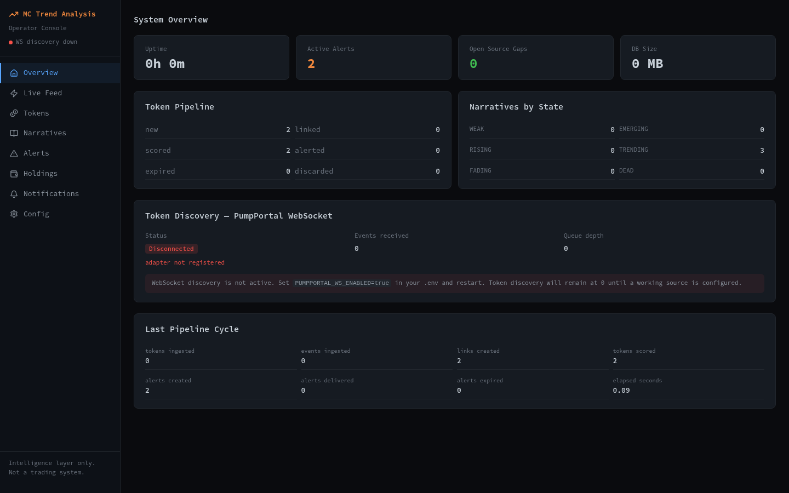
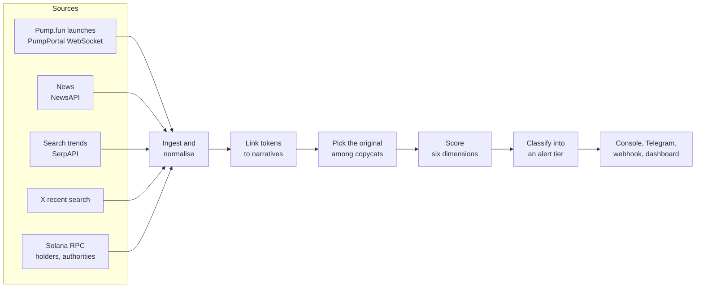
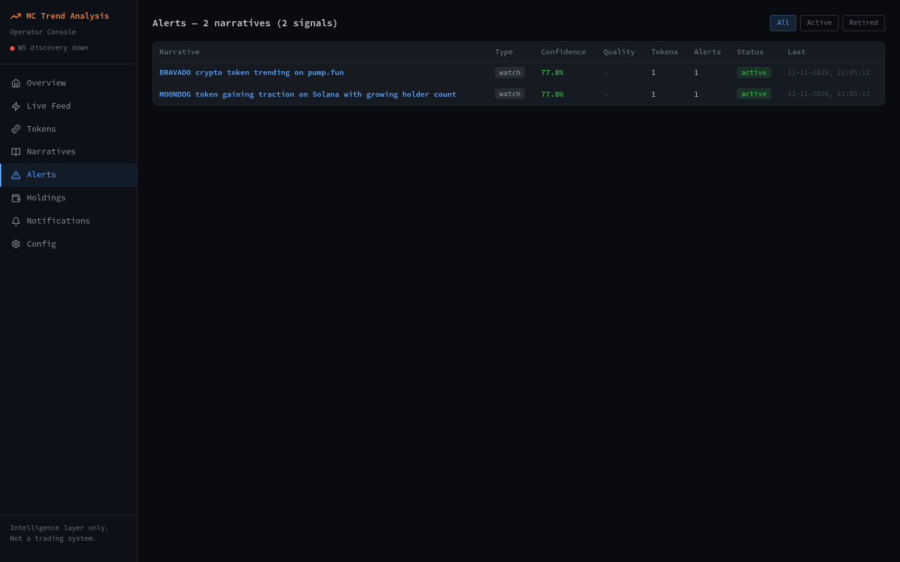
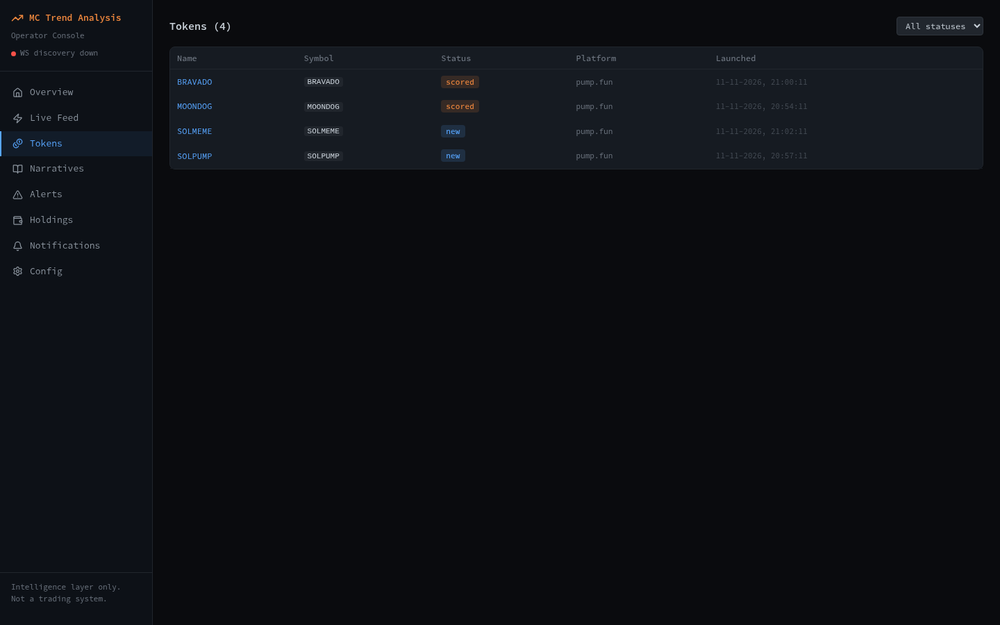

<h1 align="center">mc-trend-analysis</h1>

<p align="center">
  Reads new Pump.fun token launches, links them to what the news, search and social feeds are talking about,<br>
  and says, with its reasons, how much each one is worth a look and how likely it is to fail.
</p>

<p align="center">
  
  
  
  
  
  
</p>

<p align="center">
  
</p>

> **This is an intelligence layer. It does not trade, hold keys or place orders, and nothing it prints is financial advice.**
> Every alert is a probability estimate with its uncertainty and its missing data written next to it.

---

## Contents

- [What it does](#what-it-does)
- [Try it in two minutes (no keys)](#try-it-in-two-minutes-no-keys)
- [The dashboard](#the-dashboard)
- [How a token gets its score](#how-a-token-gets-its-score)
- [Alert tiers](#alert-tiers)
- [Running on live data](#running-on-live-data)
- [Configuration](#configuration)
- [HTTP API](#http-api)
- [Tests](#tests)
- [Repo layout](#repo-layout)
- [Limits](#limits)
- [Licence](#licence)

---

## What it does



1. **Watches launches.** New tokens come in from Pump.fun (optionally live over the PumpPortal WebSocket).
2. **Finds narratives.** News, search trends and X are grouped into narratives that move through a lifecycle: `WEAK → EMERGING → RISING → TRENDING → FADING → DEAD`.
3. **Links the two.** A four-layer name matcher ties a token to a narrative, and an "OG" resolver ranks which of several same-named tokens is the original.
4. **Scores.** Six dimensions in `[0, 1]`, combined into `P_potential`, `P_failure`, `net_potential` and a `confidence_score`.
5. **Alerts, with reasons.** A token only alerts while its narrative is `RISING` or `TRENDING`. Each alert carries the numbers, the risk flags and the data that was missing. Rejected tokens keep a record of why.

---

## Try it in two minutes (no keys)

Demo mode injects four made-up tokens and three made-up narratives and runs one real pipeline cycle over them. No network, no API keys.

```bash
git clone https://github.com/DevCrazyCube/mc-trend-analysis.git
cd mc-trend-analysis
python -m venv .venv && source .venv/bin/activate
pip install -e ".[dev]"

python -m mctrend --demo --once
```

What it prints at the end (a real run, shortened):

```text
--- Cycle Summary ---
  cycle: 1
  links_created: 2
  tokens_scored: 2
  alerts_created: 2
  alerts_delivered: 0
  narratives_evaluated: 3
  elapsed_seconds: 0.11

--- System Stats ---
  cycles_completed: 1
  total_tokens_processed: 2
  total_alerts_generated: 2
  active_alerts: 2
  open_source_gaps: 0
```

Two of the four demo tokens match a narrative and are scored; both come out as `watch` (net potential 0.40 and 0.33, confidence 0.78). `alerts_delivered` is 0 because no Telegram or webhook is configured.

---

## The dashboard

An operator console (React 19, Vite, Tailwind) served by the same process as the pipeline.

```bash
# build the dashboard once (Vite 8 needs Node 20.19+ or 22.12+)
cd dashboard && npm ci && npm run build && cd ..

# the pipeline on demo data, with the dashboard
python -m mctrend --demo --dashboard
# → http://127.0.0.1:8765
```

<table>
  <tr>
    <td width="50%"></td>
    <td width="50%"></td>
  </tr>
  <tr>
    <td align="center"><b>Alerts</b>: grouped by narrative, with tier, confidence and status</td>
    <td align="center"><b>Tokens</b>: click a name for its chain snapshot, score breakdown and alert history</td>
  </tr>
</table>

| Page | Path | Shows |
|---|---|---|
| Overview | `/` | Uptime, active alerts, tokens per pipeline stage, narratives per state, the last cycle |
| Live Feed | `/feed` | Events as they happen (server-sent events) |
| Tokens | `/tokens` | Every token with its status; detail panel per token |
| Narratives | `/narratives` | The live narrative board. It fills from the live token stream, so it is empty in demo mode |
| Alerts | `/alerts` | Active and retired alerts, grouped by narrative |
| Holdings | `/holdings` | Positions you note down by hand. Not a broker or wallet connection |
| Notifications | `/notifications` | Notifications and the delivery log |
| Config | `/config` | Current settings and scoring weights |

<details>
<summary><b>Dashboard development</b></summary>

```bash
python -m mctrend --demo --dashboard     # API on :8765
cd dashboard && npm run dev              # Vite on :5173, proxies /api to :8765
```

</details>

> **Access.** The server listens on `127.0.0.1` by default. With `DASHBOARD_API_KEY` empty, anyone who can reach the port can read and change the configuration; set a key before exposing it. `ENVIRONMENT=prod` refuses to start without one.

---

## How a token gets its score

| Dimension | What it measures | Weight in `P_potential` |
|---|---|---|
| Narrative relevance | How well the token matches a real narrative | 0.25 |
| OG score | How likely it is the original, not a copycat | 0.20 |
| Momentum quality | Organic trading versus manufactured | 0.20 |
| Attention strength | How much real-world attention the narrative has | 0.20 |
| Timing quality | Where the narrative is in its lifecycle | 0.15 |
| Rug risk | Deployer history, holder concentration, clustering, liquidity, contract | goes into `P_failure` |

```text
P_potential   = weighted sum of the five positive dimensions
P_failure     = 0.35 rug risk + 0.25 fakeout + 0.20 exhaustion + 0.10 copycat capture + 0.10 liquidity
net_potential = P_potential × (1 − P_failure)
confidence    = how much evidence there was: source count, source diversity, data completeness, ambiguity
```

Missing data lowers the confidence and is listed in `data_gaps`; it is never filled in with a guess that looks like a measurement. The weights are documented reasoning, not the result of a backtest (see [Limits](#limits)).

Full write-up: [`docs/intelligence/scoring-model.md`](docs/intelligence/scoring-model.md), [`probability-framework.md`](docs/intelligence/probability-framework.md), [`rug-risk-framework.md`](docs/intelligence/rug-risk-framework.md).

---

## Alert tiers

Checked in this order; the first that fits wins.

| Tier | Needs | Expires after |
|---|---|---|
| `discard` | `P_failure ≥ 0.80`, or net `< 0.10`, or a known bad deployer | – |
| `exit_risk` | `P_failure ≥ 0.65` on a token that already has an alert | 15 min |
| `possible_entry` | net `≥ 0.60`, `P_failure < 0.30`, confidence `≥ 0.65`, narrative active, no blocking flag | 60 min |
| `high_potential_watch` | net `≥ 0.45`, `P_failure < 0.50`, confidence `≥ 0.55`, narrative active, no blocking flag | 120 min |
| `take_profit_watch` | an earlier top-tier alert, net still `≥ 0.35`, narrative `TRENDING` or `FADING` | 30 min |
| `verify` | net `≥ 0.35` but confidence `< 0.55` | 120 min |
| `watch` | net `≥ 0.25` | 240 min |

"Narrative active" means `EMERGING`, `RISING` or `TRENDING`. A blocking flag (`CRITICAL_RUG_RISK`, or mint and freeze authority both still active) keeps a token out of the two top tiers. The tier names describe how strong the evidence is. They are not instructions.

Details: [`docs/alerting/alert-types.md`](docs/alerting/alert-types.md).

---

## Running on live data

```bash
cp .env.example .env        # then fill in what you have
python -m mctrend --status  # which sources are configured
python -m mctrend --once    # one cycle
python -m mctrend           # continuous
python -m mctrend --dashboard
```

| Flag | Does |
|---|---|
| `--demo` | Synthetic data, one cycle. With `--dashboard`: keeps serving it |
| `--once` | One cycle, then exit |
| `--status` | Print source and system status, then exit |
| `--dashboard` | Serve the API and the built dashboard alongside the pipeline |
| `--env <file>` | Read settings from another file (default `.env`) |

Exit codes: `1` startup validation failed, `2` database schema version mismatch, `3` fatal error.

<details>
<summary><b>Docker</b></summary>

```bash
make docker-demo            # one demo cycle in a container
cp .env.prod.example .env   # set DASHBOARD_API_KEY and your keys
docker-compose up           # continuous, data in the mctrend_data volume
```

</details>

Every source is optional. A source without a key is reported as unconfigured and the rest keep working; fewer sources means a lower confidence score.

---

## Configuration

The full list with comments is in [`.env.example`](.env.example). The ones that matter first:

| Variable | Default | For |
|---|---|---|
| `SOLANA_RPC_URL` | public mainnet endpoint | Holder and authority data |
| `PUMPPORTAL_WS_ENABLED` | `false` | Live token discovery. Without it no new tokens arrive |
| `NEWSAPI_KEY` | – | News narratives |
| `SERPAPI_KEY` | – | Search-trend narratives |
| `X_ENABLED`, `X_API_BEARER_TOKEN` | `false`, – | X recent search |
| `TELEGRAM_BOT_TOKEN`, `TELEGRAM_CHAT_ID` | – | Alerts to Telegram |
| `WEBHOOK_URL`, `WEBHOOK_SECRET` | – | Alerts as JSON POST, signed with HMAC-SHA256 in `X-Signature-256` |
| `DASHBOARD_HOST`, `DASHBOARD_PORT` | `127.0.0.1`, `8765` | Where the dashboard listens |
| `DASHBOARD_API_KEY` | – | Requires `Authorization: Bearer <key>` on every API call |
| `ENVIRONMENT` | `demo` | `demo`, `dev` or `prod` |
| `DATABASE_PATH` | `data/mctrend.db` | SQLite file |
| `CONFIDENCE_FLOOR_FOR_ALERT` | `0.25` | No alert below this confidence |
| `ALERT_RATE_LIMIT_PER_10MIN` | `6` | Push alerts per channel per 10 minutes |
| `MAX_TOKEN_AGE_HOURS` | `4` | Older tokens are not scored |

---

## HTTP API

Interactive docs at `/api/docs` while the dashboard server runs.

| Method | Path | Returns |
|---|---|---|
| GET | `/api/health`, `/api/health/sources`, `/api/health/silence` | System, source and quiet-period status |
| GET | `/api/tokens`, `/api/tokens/{token_id}` | Tokens; one token with snapshot, links, scores, alerts |
| GET | `/api/narratives`, `/api/narratives/board`, `/api/narratives/{narrative_id}` | Narratives and the live board |
| GET | `/api/alerts?status=active\|retired`, `/api/alerts/by-narrative`, `/api/alerts/{alert_id}` | Alerts |
| GET | `/api/candidates`, `/api/competition` | Token-stream candidates; which narrative and token won |
| GET | `/api/events/stream` | Server-sent events |
| GET, PATCH | `/api/config`, `/api/config/weights` | Settings and weights |
| GET, POST, PUT, DELETE | `/api/holdings…` | Your own notes on holdings and wallets |
| GET, POST | `/api/notifications…` | Notifications and delivery log |

```bash
curl -s http://127.0.0.1:8765/api/alerts?status=active | python -m json.tool
```

---

## Tests

```bash
python -m pytest tests/ -q          # 882 tests
cd dashboard && npm test            # 22 tests (vitest)
```

Both suites pass on this branch (Python 3.13, Node 26). The Python suite covers scoring, the probability maths, rug risk, OG resolution, alert classification, normalisation, the API routes and an end-to-end pipeline run on demo data.

What the tests do not cover: the live adapters against the real services. Their tests use stand-in responses, not PumpPortal, NewsAPI, SerpAPI, X or a Solana RPC node.

---

## Repo layout

```text
src/mctrend/
  config/          settings, weights, thresholds
  models/          pydantic domain models
  ingestion/       source adapters: pumpfun, pumpportal_ws, news, trends, x_api, solana_rpc
  normalization/   canonical records
  correlation/     name matching (4 layers), OG resolution
  narrative/       narrative lifecycle, quality and competition
  scoring/         six dimensions and the probability framework
  alerting/        classification, alert lifecycle, reasoning text
  delivery/        console, Telegram, webhook, rate limiting
  persistence/     SQLite (WAL) and typed repositories
  api/             FastAPI app, routes, auth, dashboard file serving
  pipeline.py      the cycle
  runner.py        CLI
dashboard/         React operator console
docs/              design docs: core, architecture, intelligence, alerting, operations
tests/             unit and integration
```

Where to read first: [`docs/core/00-project-overview.md`](docs/core/00-project-overview.md), then [`docs/architecture/event-flow.md`](docs/architecture/event-flow.md) for one token from launch to alert, and [`docs/core/03-scope-and-non-goals.md`](docs/core/03-scope-and-non-goals.md) for what this will never do.

---

## Limits

- **Not validated against history.** There is no backtest. The weights and thresholds are reasoned, not fitted, so the scores rank evidence; they do not predict prices.
- **Only the demo and the tests were run for this README.** The live sources need your own keys and their behaviour depends on those services.
- **Data quality varies.** Check `confidence_score` and `data_gaps` on every alert before reading anything into it.
- **One chain.** Solana and Pump.fun only.
- **One operator.** SQLite, one process, an optional single API key. It is built to run on your own machine or a small server, not as a multi-user service.
- **Most new tokens fail.** A high score means the observed signals look better than most. It does not mean safe.

**How it was built:** by directing AI coding agents (Claude Code) from the design documents in `docs/`, which were written first; [`CLAUDE.md`](CLAUDE.md) holds the working rules the agents follow.

---

## Licence

[MIT](LICENSE). Not financial advice.
